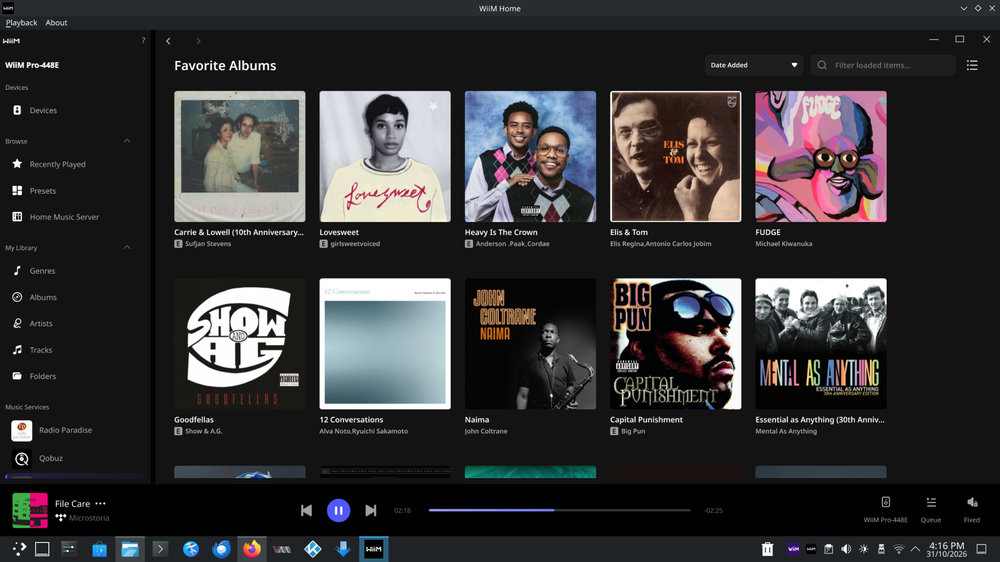
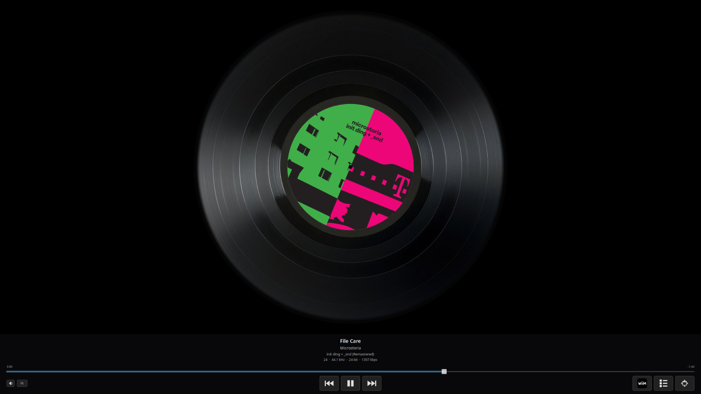
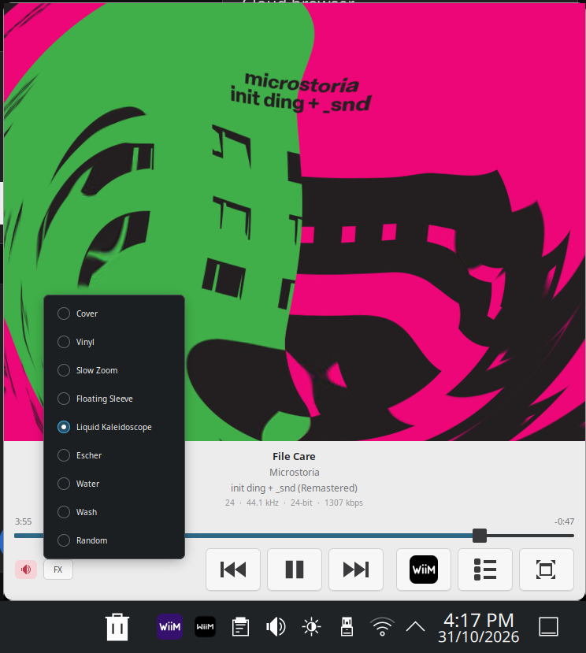
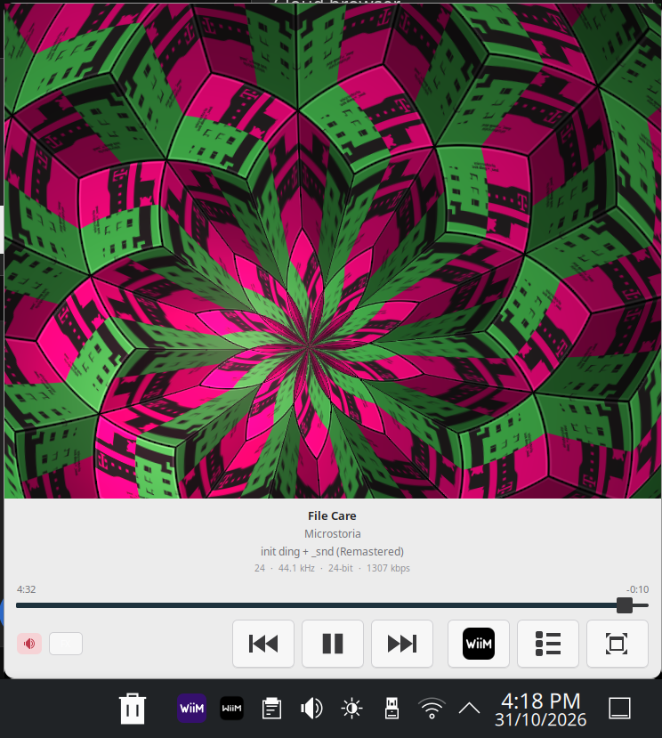
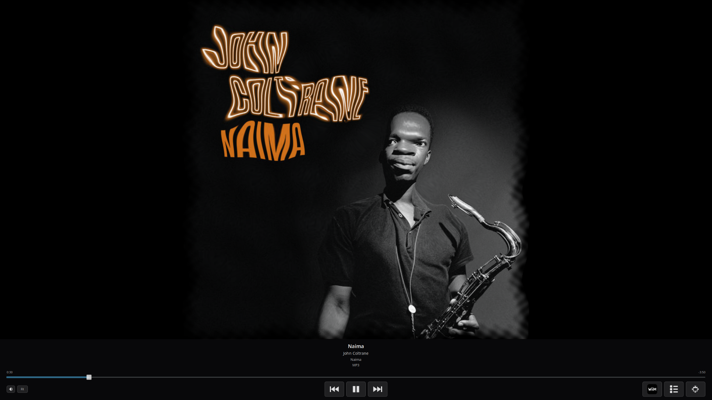
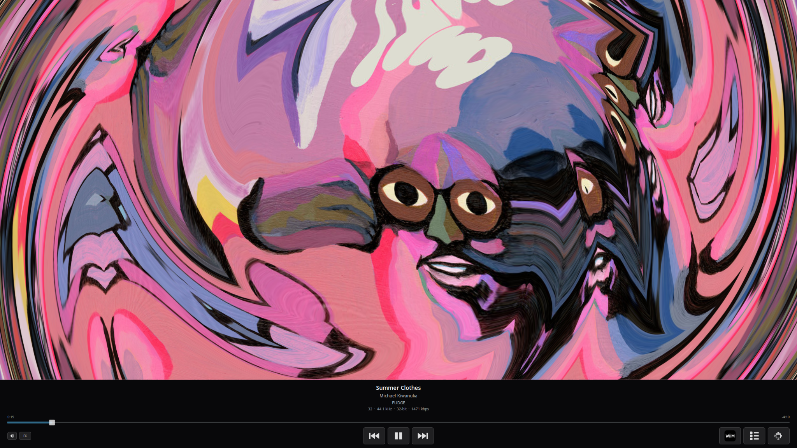

# WiiM Home Linux & WiiM Mini

Community Linux compatibility tooling for WiiM Home, plus a standalone GTK mini player with fullscreen album-art effects. This is an unofficial project and is not affiliated with WiiM. The was ported from the lastest macos wiim home dmg (30/10/2026).

## Upstream credits

The WiiM Home conversion tooling in this repository is derived from **[clauded/wha-linux](https://github.com/clauded/wha-linux)**, based on its **0.2.10.4** converter. Substantial portions of that tooling are reused here. Credit for the original Linux conversion approach and implementation belongs to the upstream project.

The [upstream credits](https://github.com/clauded/wha-linux#credits) name **Malfman** as the original author and **clauded** and **Samuel-Boehm** as contributors. Samuel-Boehm's listed contributions relate to the later 0.2.10.5 work; this repository's original converter base is 0.2.10.4.

The upstream tooling extracts WiiM Home's platform-independent Python/Qt code and resources from a user-supplied official macOS DMG, sets up a Linux runtime, and applies compatibility patches. It is specific to WiiM Home, rather than a general macOS-to-Linux converter. The WiiM Home application itself remains WiiM's work.

This repository adds distribution packaging, additional compatibility fixes, TIDAL startup and tray/Mini integration patches, and KDE setup scripts. **WiiM Mini** (`mini/wiim_tray.py`) is a separate GTK player developed for this project, with its own controls and artwork effects; it is not the upstream WiiM Home converter or the official WiiM Home interface.

Thank you to the upstream authors and contributors for making the Linux conversion tooling available.

## Screenshots

### WiiM Home on KDE



### Mini fullscreen vinyl



### Liquid effect and effect selector



### Escher effect



### More fullscreen artwork FX





## Included files

| Directory | Contents |
| --- | --- |
| `packages/` | Fedora RPM 0.2.10.4-3 and Debian/Ubuntu DEB 0.2.10.4-1 |
| `source/` | Launcher, setup wrapper, desktop entry and embedded converter source extracted from the supplied DEB |
| `mini/wiim_tray.py` | Latest supplied WiiM Mini source, including embedded artwork assets |
| `patches/` | TIDAL startup and native tray/Mini bridge patches |
| `packaging/` | DEB/RPM build recipes and repackaging instructions |

See [repackaging instructions](packaging/README.md) for other distributions, including extracted converter source and source-RPM generation.

The packages install compatibility tools, not the proprietary WiiM Home application. Supply your own official **macOS x86_64 DMG**. The converter checks its supported installer hashes; a different/newer DMG may require a converter update. Conversion downloads runtime dependencies.

## Dependencies on newer Linux distributions

These instructions target recent **x86_64 Fedora KDE and Ubuntu/Kubuntu** installations. Other distributions need equivalent packages. WiiM Home conversion requires an official macOS **x86_64** DMG; the supplied converter is not an ARM build.

| Component | Requirements |
| --- | --- |
| WiiM Mini | System Python 3, GTK **3**, PyGObject, Pycairo and GI Cairo integration |
| Mini artwork FX | Working OpenGL driver (Mesa on Intel/AMD), X11 or XWayland |
| WiiM Home setup | Bash, Python 3, `uv`, 7-Zip providing `7z`, Qt 6 resource compiler (`rcc`), CA certificates and Internet access |
| WiiM Home desktop runtime | Qt platform/system libraries, including XCB/XKB and OpenGL/EGL |
| Desktop integration | A desktop session with D-Bus and a system tray; KDE Plasma provides these |

Use distribution packages for Mini's GTK/Python bindings. Do not install its dependencies with `sudo pip`, and run Mini with the system Python. No separate NumPy, Pillow, PyOpenGL or AppIndicator Python package is required by Mini.

### Fedora KDE

Install dependencies for **both Home and Mini**:

```bash
sudo dnf install git curl ca-certificates python3 python3-gobject python3-cairo \
  gtk3 xorg-x11-server-Xwayland mesa-dri-drivers libglvnd-glx libglvnd-egl \
  uv 7zip qt6-qtbase qt6-qtbase-gui qt6-qtwayland qt6-qttools \
  libxkbcommon-x11 xcb-util-cursor
```

The Home RPM also declares its Home-specific dependencies; installing it with `dnf` resolves those automatically.

### Ubuntu / Kubuntu

Install dependencies for **both Home and Mini**:

```bash
sudo apt update
sudo apt install git curl ca-certificates python3 python3-gi python3-gi-cairo \
  python3-cairo gir1.2-gtk-3.0 xwayland libgl1 libegl1 libgl1-mesa-dri \
  7zip qt6-base-dev-tools qt6-wayland libxkbcommon-x11-0 libxcb-cursor0
```

If a package cannot be located, check that Ubuntu's **Universe** repository is enabled. Package availability depends on the release.

Install `uv` with `sudo apt install uv` if your release provides it. Otherwise use the [official uv installer](https://docs.astral.sh/uv/getting-started/installation/), as your normal user:

```bash
curl -LsSf https://astral.sh/uv/install.sh | sh
export PATH="$HOME/.local/bin:$PATH"
uv --version
```

Do not use `sudo` for the uv installer or for `wiim-home-setup`. The converter downloads its own Python 3.9.25 runtime and pinned packages, including PySide6, into the user installation. You do not need to replace your distro's Python or manually install those packages globally.

### Quick dependency checks

Run these in a terminal inside your desktop session:

```bash
python3 - <<'PY'
import gi
gi.require_version("Gtk", "3.0")
gi.require_foreign("cairo")
from gi.repository import Gtk, Gdk, GdkPixbuf, Gio
import cairo
import ctypes
ctypes.CDLL("libGL.so.1")
print("WiiM Mini: GTK 3, GI/Cairo and OpenGL library available")
PY
command -v uv
command -v 7z
```

The Mini check verifies imports/libraries, not actual GPU performance. Qt's `rcc` is often outside PATH; the converter also checks `/usr/lib/qt6/libexec/rcc` and `/usr/lib64/qt6/libexec/rcc`.

The converter currently calls **`7z`**, not `7zz`. If your distribution installs only `7zz`, add a user-local compatibility link:

```bash
if ! command -v 7z >/dev/null && command -v 7zz >/dev/null; then
  mkdir -p "$HOME/.local/bin"
  ln -s "$(command -v 7zz)" "$HOME/.local/bin/7z"
fi
export PATH="$HOME/.local/bin:$PATH"
```

For **Mini only**, skip the Home-only packages (`uv`, 7-Zip and Qt 6). For repackaging, see [build requirements](packaging/README.md); end users do not need RPM/DEB build tools.

Dependency references: [PyGObject installation](https://pygobject.gnome.org/getting_started.html), [Cairo integration](https://pygobject.gnome.org/guide/cairo_integration.html), [Fedora uv package](https://packages.fedoraproject.org/pkgs/uv/uv/), and [Ubuntu uv availability](https://packages.ubuntu.com/uv). PyGObject's generic examples use GTK 4; this application explicitly requires GTK 3.

## Install WiiM Home

Clone this repository and enter it:

```bash
git clone https://github.com/grantcolin/wiim_home_linux.git
cd wiim_home_linux
```

Fedora KDE:

```bash
sudo dnf install ./packages/wiim-home-linux-0.2.10.4-3.fc44.noarch.rpm
```

Kubuntu / Ubuntu:

```bash
sudo apt install ./packages/wiim-home-linux_0.2.10.4-1_amd64.deb
```

Install `uv` and `7z` if they are not already available, then convert your official installer **as your normal user**:

```bash
wiim-home-setup "$HOME/Downloads/WiiM Home Setup-x86_64.dmg"
```

Use the actual path to your DMG. After successful setup, close WiiM Home completely and apply the patches as the same user:

```bash
bash patches/wiim-home-enable-tidal.sh
bash patches/wiim-home-tray-final-updated.sh
wiim-home
```

The TIDAL patch opens TIDAL automatically after startup; it does not supply an account or subscription. The tray patch reuses WiiM Home's native tray icon, provides Show/Hide, keeps the app running when its window closes, and adds the local bridge used by WiiM Mini to bring Home forward. Reapply patches after rebuilding the converted app.

## Install WiiM Mini

Requires Python 3, GTK 3, PyGObject, Cairo bindings, a working OpenGL/Mesa driver, and X11/XWayland. The source requests the X11 backend for KDE window positioning. Keep the computer and WiiM device on the same local network.

From the repository directory:

```bash
mkdir -p "$HOME/.local/bin"
install -m 755 mini/wiim_tray.py "$HOME/.local/bin/wiim_tray.py"
python3 "$HOME/.local/bin/wiim_tray.py"
```

WiiM Mini includes playback controls, a volume popup, queue access, track/audio details, a deep-purple tray icon, and a fullscreen toggle. Fullscreen controls hide after 15 seconds of inactivity. Animated effects include Vinyl, Slow Zoom, Floating Sleeve, Liquid, Escher, Water and Wash; Random changes effects every two minutes. Rendering pauses while hidden in the tray.

### KDE menu icon and autostart

Run this as your normal user from the cloned repository:

```bash
bash scripts/setup-kde-mini.sh
```

This creates a deep-purple WiiM Mini icon in the KDE application menu and enables autostart at login. If Mini is already installed in `~/.local/bin/wiim_tray.py`, it is preserved. Otherwise the script installs the repository copy. It does not start another player instance immediately. You can disable autostart later in KDE System Settings → Autostart.

## Troubleshooting

- Launch either app from a terminal to see errors. WiiM Mini: `python3 "$HOME/.local/bin/wiim_tray.py"`.
- If Home cannot be raised from Mini, apply the included tray patch after conversion and restart Home.
- A remembered album cover does not necessarily mean a playable queue exists. Queue errors can originate on the WiiM device.
- GPU performance varies with display resolution and drivers. No minimum frame rate is guaranteed.
- These are the user's supplied working builds; syntax checks do not replace fresh installation testing on every distribution.

## Source and provenance

The initial snapshot preserves all five files from `wiim_home_linux(2).zip` byte-for-byte. They match the saved `wiim_home_linux_fix3.zip`. The extra `source/` files are extracted from the included DEB, rather than copied from an older source archive. The RPM and DEB retain their original versions and have not been rebuilt for this publication.

`SHA256SUMS` records the packaged files, patches and Mini source. No proprietary DMG or converted application runtime is included. Existing third-party notices in the tooling remain applicable; publication does not grant rights to WiiM's application or trademarks.
